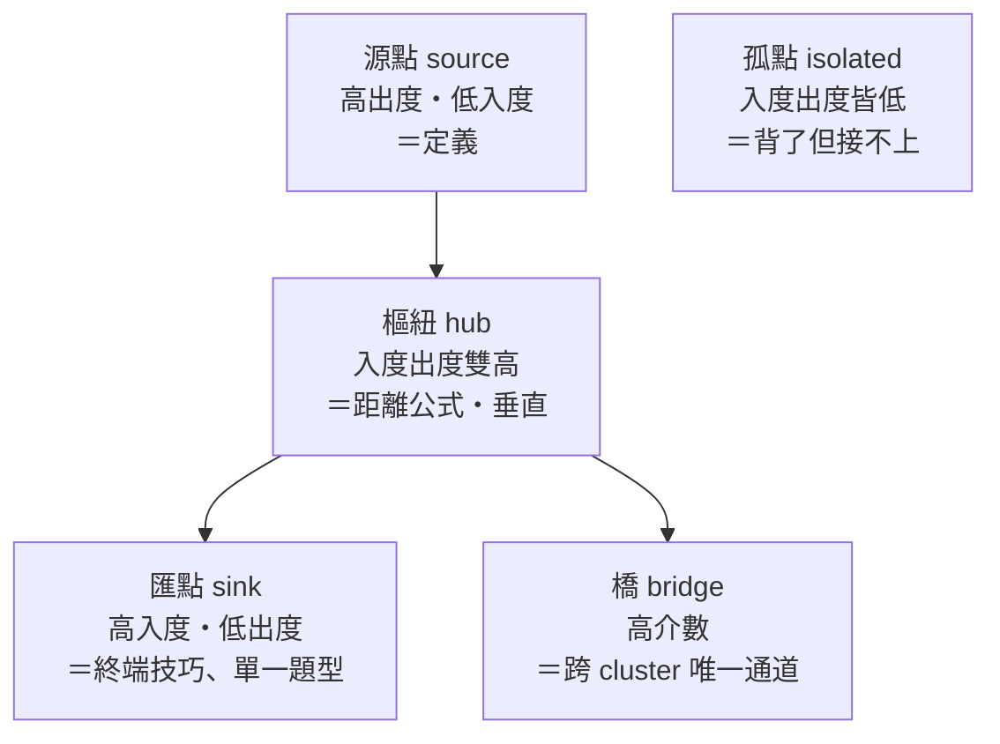
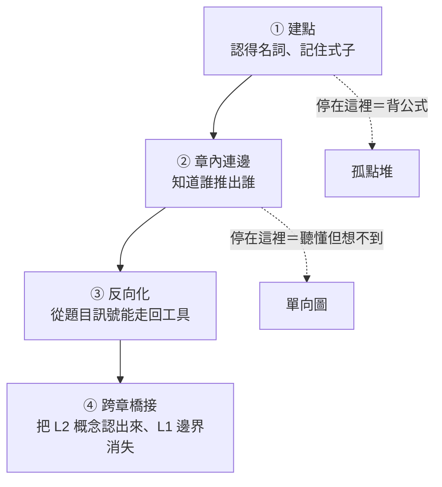

# 知識網理論 — 圖譜定義

> [!info] 這份檔案的定位
> 這是所有 **Chapter Map 的上位規格書**：定義「節點是什麼、邊是什麼、怎麼算重要、怎麼算學會了」。
> 每一份 chapter map 都是這套規格的一個實例（§7 有對照表）。
> 原始六條公理保留為 §0，其後為補完。
> 教師端如何實際編輯這張圖（媒介、流程、課程設計後果）見 [[教師端 — 媒介與流程評估]]。

---

## §0 原始公理（不動）

1. 知識類型分為 node & edge
2. node：{章節型概念、通用（跨章節）型概念}
3. edge 代表 node 的關聯性，通常代表 {章節內部的知識鏈、跨章節的知識網}
4. node 的入度越高代表觀念越重要
5. 存在 cluster，主要分類 {章節、大型概念、通用概念}
6. 學習概念本質就是增加知識點之間的連結

---

## §1 形式定義

> [!important] 知識網
> $$G=(V,\;E,\;\tau_V,\;\tau_E,\;w,\;\mathcal C)$$
> - $V$：節點集合（知識點）
> - $E\subseteq V\times V$：**有向**邊集合（$G$ 是有向、帶型別、帶權的多重圖——兩點之間可以同時有不同型別的邊）
> - $\tau_V:V\to$ 節點型別（§2）
> - $\tau_E:E\to$ 邊型別（§3）
> - $w:E\to[0,1]$：邊權＝**這條連結目前的可用強度**（§6）
> - $\mathcal C$：cluster 的階層分解（§5）

三個關鍵補充，分別修正公理 1、3、6 的模糊處：

- **邊是有向的。** 「A 和 B 有關」不是一條邊，是兩條方向相反、強度往往差很多的邊。這是整套理論最重要的一條（§3.2）。
- **邊是分型的。** 「前置關係」和「看到題目就想到」是完全不同的東西，混在一起畫就會得到一張看得懂卻用不了的圖。
- **邊是帶權的，而且會衰減。** 學會 ≠ 永久持有，複習是在維持 $w$（§6）。

---

## §2 節點：兩軸分類

公理 2 的 {章節型, 通用型} 是**作用域**軸。補上正交的**角色**軸，節點 $=$（作用域, 角色）。

| 作用域 scope | 意義 | 例 |
|---|---|---|
| 章節型 | 只在單一章節有效 | 弦心距、圓冪 |
| 大型概念 | 橫跨數個章節的骨架 | 距離、垂直、平均變化率 |
| 通用型 | 全域可用的思維動作 | 對稱、參數化、極端原理、以形代數 |

| 角色 role | 記號 | 說明 |
|---|---|---|
| 定義 | D | 名詞的意義（圓＝圓心＋半徑） |
| 定理／性質 | T | 可被證明的敘述（切線 ⊥ 半徑） |
| 公式／工具 | F | 可直接計算的式子（點到直線距離） |
| 程序／技巧 | P | 多步驟操作（先求垂足再取鏡像） |
| 題型訊號 | S | 題目表面特徵（「$k$ 只出現在常數項」） |
| 陷阱／邊界 | X | 失效條件（鉛垂線沒有斜率） |
| 表徵 | R | 同一件事的另一種長相（代數式 ↔ 圖像） |

> [!note] 為什麼要有 S 和 X 這兩種節點
> 它們不是「知識」，是**入口與護欄**。
> - 沒有 S 節點，圖是「懂了但想不到」——這正是 chapter map §4 觸發表要補的。
> - 沒有 X 節點，圖是「會用但會踩雷」——X 的入度高低直接對應扣分頻率。

**節點的抽象高度** $h(v)$：D/T 高、F/P 中、S 低。健康的圖在**每一層都有節點**；只有 F 的圖是公式表，不是知識網。

---

## §3 邊：型別、方向、與可逆性

### 3.1 七種邊型

| 型別 | 符號 | 語義 | 典型走向 |
|---|---|---|---|
| 前置 prerequisite | $A\Rightarrow B$ | 不會 A 就學不了 B | D → T → F |
| 推導 derivation | $A\vdash B$ | B 可由 A 推出來 | T → F |
| 特化／推廣 | $A\sqsubset B$ | A 是 B 的特例 | 雙向可走 |
| 等價／翻譯 | $A\equiv B$ | 同一件事的兩種表徵 | **本質雙向** |
| 觸發 trigger | $S\rightsquigarrow F$ | 看到訊號就取用工具 | S → F/P |
| 對比 contrast | $A\;\|\;B$ | 易混淆、須辨異 | 雙向 |
| 組合 composition | $A\circ B$ | 兩工具串成一招 | 有序 |

### 3.2 方向性：這是「懂了卻不會寫」的全部解釋

> [!important] 前向邊 vs 反向邊
> 對同一組關聯，存在兩條方向相反的邊，強度獨立：
> - **前向（演繹）**：工具 → 結果。「距離公式怎麼用」——上課聽懂就有。
> - **反向（檢索）**：情境 → 工具。「看到什麼會想到距離公式」——只有練題會長。
>
> $$w_{\text{前向}} \gg w_{\text{反向}} \iff \text{「老師講我都懂，考試想不到」}$$

**考試分數幾乎只由反向邊決定。** 所以 chapter map 的 §4 觸發表不是附錄，它是把反向邊獨立列出來訓練的專章；§3 關聯網練的則是前向邊的完整性。

### 3.3 邊權 $w$ 的意義

$w(e)$ 混合三件事：**是否存在**（0＝斷邊）、**檢索速度**、**穩定度（抗變形）**。
實務判準：$w\approx1$＝看到就走、$w\approx0.5$＝想一下才通、$w\approx0.2$＝提示後才通、$w=0$＝斷。

---

## §4 中心性：把公理 4 講精確

公理 4 說「入度高＝重要」，方向對，但單一指標不夠。四個指標各自指向**不同的教學動作**：

| 指標 | 定義 | 意義 | 對應動作 |
|---|---|---|---|
| 入度 $\deg^-$ | 多少條邊指向它 | **被依賴度**＝基礎性 | 必須先修、不可有洞 |
| 出度 $\deg^+$ | 它指出多少條邊 | **生成力**＝應用廣度 | 值得一題多用地練 |
| 介數 betweenness | 多少最短路徑經過它 | **橋樑性**＝跨章節樞紐 | 混合題的命題點 |
| 反向入度 | 多少 S 節點觸發它 | **可檢索性** | 考前只複習這些 |

由此得到四種節點人格：

> [!warning] 孤點是最危險的節點
> 入度出度都低卻仍記得的節點，通常是「硬背的公式」。它不會幫你解題，只會佔記憶體並在變形題製造誤用（假邊，§6）。
> 處理方式不是刪掉，是**替它找兩條入邊**（它從哪裡來？在什麼訊號下用？）。

**一條經驗律**：$\deg^-$ 高的節點錯了 → 全章崩；betweenness 高的節點錯了 → 跨章混合題全崩、單章題卻正常。這解釋了「小考都會、模擬考壞掉」。

---

## §5 Cluster：階層與模組度

公理 5 的三類 cluster 不是並列，是**三層巢狀**，且成因不同：

| 層 | 成因 | 邊界由誰決定 | 例 |
|---|---|---|---|
| L1 章節 | **外生**：教材切分 | 課本目錄 | Ch3 直線與圓 |
| L2 大型概念 | **內生**：由 hub 誘導出的密集子圖 | 圖自己長出來 | 「距離家族」「垂直家族」 |
| L3 通用概念 | **跨層**：覆蓋全域的思維模式 | 學習者的抽象能力 | 對稱、參數化、極值 |

> [!important] 模組度與學習成熟度
> 定義章節間邊密度佔比
> $$\beta=\frac{|E_{\text{跨章}}|}{|E|}$$
> - **新手**：$\beta\approx0$。每章是孤島，題目一混合就沒方向。
> - **成熟**：$\beta$ 明顯上升，L2 cluster 開始**橫切**章節邊界（例：距離家族同時吃 Ch3 直線與圓、向量、Ch6 變異數的一維投影）。
>
> **學習的目標不是把每個 L1 填滿，是讓 L2 長出來把 L1 縫起來。** L2 一旦成形，記憶量反而下降——很多章節型節點被降級成 hub 的特例，不必獨立記。

**橋邊稀缺定律**：跨章邊在數量上是少數，在價值上是多數。學測非選與混合題幾乎全部踩在橋邊上，而橋邊是課本結構**最不會主動提供**的東西——它必須靠 chapter map 這種橫向文件人工鋪設。

---

## §6 學習動力學：把公理 6 展開

公理 6 說「學習＝增加連結」。補完為四階段 ＋ 一組維護律。

### 6.1 四階段

大多數學生卡在 ② → ③ 之間：圖是完整的，但**只能順著走**。突破手段是刻意的反向練習——遮住解法只讀題幹，先問「這題在觸發什麼」。

### 6.2 遺忘與維護

$w$ 隨時間衰減，且**邊比點衰減得快**（節點靠語意冗餘支撐，邊沒有）。
推論：複習不該重讀定義（點還在），該重走連結——最有效率的複習物件是 §4 觸發表，不是 §2 定義區。

### 6.3 診斷學：把「錯題」翻譯成圖的故障

> [!tip] 訂正時先分類故障，再決定怎麼補
> | 故障 | 症狀 | 修法 |
> |---|---|---|
> | **缺點** missing node | 名詞沒看過 | 補概念（最少見，也最好修） |
> | **斷邊** missing edge | 每個字都懂，就是接不起來 | 補一條有向邊到 §3 關聯網 |
> | **反向邊缺失** | 看解答秒懂、自己想不到 | 寫進 §4 觸發表，記下「訊號」 |
> | **假邊** false edge | 把不成立的關係當定理用 | 建 contrast 邊＋X 節點（例：以為斜率恆存在） |
> | **邊權過低** | 會做但太慢／緊張就斷 | 重複走同一條邊，不是學新東西 |
> | **橋斷** | 單章題全對、混合題全錯 | 專攻高介數節點 |
>
> **絕大多數錯題是斷邊與反向邊缺失，不是缺點。** 因此「這題不會 → 再看一次課本」通常是無效訂正：課本補的是點。

### 6.4 一個推論：進度不該用「讀完幾章」衡量

用點數衡量進度會嚴重高估。合理的量測是
$$\text{掌握度}\;\propto\;\sum_{e\in E}w(e)\quad\text{而非}\quad|V|$$
且應分開追蹤 $\beta$（跨章邊佔比）與反向邊覆蓋率。

---

## §7 與 Chapter Map 四段結構的對照

現有 chapter map 其實已經是這套理論的實作，四段各自負責圖的一個面向：

| Chapter Map 段落 | 圖論對應 | 產出什麼 |
|---|---|---|
| §1 全章心智圖 | **cluster 分解＋主幹邊** | L1 邊界、subgraph 分群 |
| §2 逐頁解析 | **節點定義**（D/T/F/P/X） | $V$ 及其屬性、陷阱節點 |
| §3 概念關聯網 | **前向邊＋hub 標定** | 高入度樞紐（🔑 標記）、L2 cluster |
| §4 題目聯想表 | **反向（觸發）邊** | $S\rightsquigarrow F$，唯一直接對應分數的一節 |

> [!note] 兩個目前的缺口
> 1. **跨章節邊沒有專屬載體。** §3 只畫章內網。建議未來新增一份 `跨章橋接網.md`，只放橋邊——它的價值密度最高，卻沒有任何一份 chapter map 天然容納它（Ch3 的「距離」與 Ch6 的「一維投影／變異數」就是現成的一條橋）。
> 2. **邊沒有權重紀錄。** 目前所有邊都預設 $w=1$。若要讓複習排程可計算，需要在觸發表裡加一欄自評強度。

---

## §8 這套模型的邊界

不要過度延伸。圖譜刻畫的是**知識的結構**，不是全部的考試能力：

- **計算熟練度與正確率**是節點內部屬性，不是邊——圖再漂亮也救不了算錯。
- **時間分配與選題策略**在圖之外。
- **邊的存在性無法自我檢驗**：學生常誤以為某條邊存在（假邊），而假邊只能靠「做題失敗」被動偵測。這是為什麼練題不可替代——它是唯一的邊測試工具。

